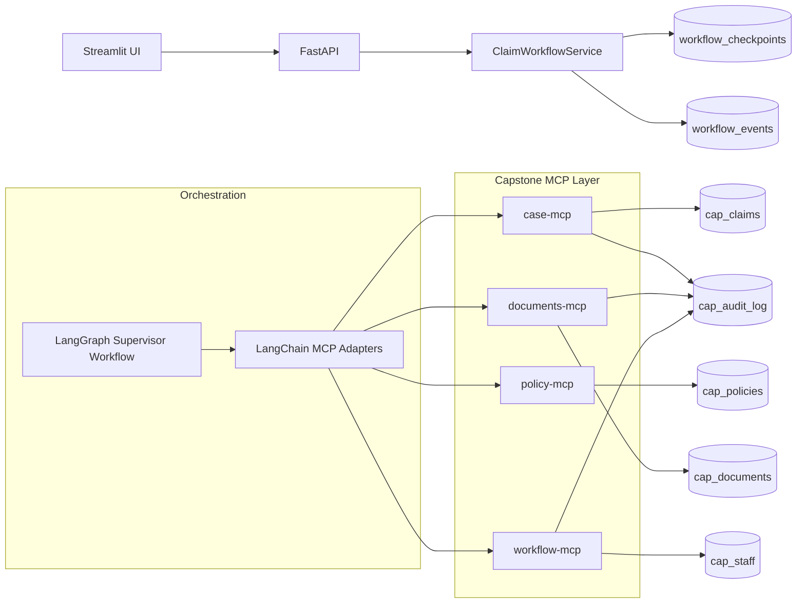

# Technical Deep Dive: Intelligent Claims Agent

## 1) What This Project Is

This project is a governed claims-processing system built in two complementary layers:

- A production-style API and UI workflow for claim intake, pause/resume, human decision, and audit trace.
- A capstone architecture that demonstrates LangGraph orchestration and MCP-based tool/resource/prompt access across domain services.

The core design principle is: agents can prepare analysis, but only humans finalize claim decisions.

## 2) High-Level Architecture

## 3) Database Used

The code supports both SQLite and PostgreSQL through SQLAlchemy.

- Default local database: `sqlite+pysqlite:///claims_agent.db`
- Optional database: PostgreSQL via `DB_URL`

Why both:

- SQLite gives a zero-setup local dev experience.
- PostgreSQL is the durable multi-service option for containerized and team workflows.

## 4) Database Tables, Relations, and Purpose

There are two data domains in this repository.

## 4.1 Core Workflow Tables (API/Service path)

### Table: `workflow_checkpoints`

Purpose:

- Stores the latest full serialized workflow state per run.
- Enables pause/resume and crash-safe continuation.

Columns:

- `run_id` (PK)
- `status`
- `current_step`
- `state_json` (full `WorkflowState` snapshot)
- `updated_at`

### Table: `workflow_events`

Purpose:

- Append-only timeline of everything that happened during execution.
- Used by trace/replay endpoints and audit-style review.

Columns:

- `id` (PK)
- `run_id`
- `step`
- `event_type`
- `message`
- `payload_json`
- `created_at`

Relation:

- Logical 1-to-many: one `workflow_checkpoints.run_id` -> many `workflow_events.run_id`
- Note: relation is enforced by application logic, not DB foreign key constraints.

## 4.2 Capstone MCP Tables

### Table: `cap_claims`

Purpose:

- Canonical claim/case record for capstone path.

Columns (key ones):

- `case_id` (PK)
- `policy_number`
- `amount`
- `status`
- `assigned_adjuster`
- `assigned_approver`
- `summary_json`
- `created_at`, `updated_at`

### Table: `cap_documents`

Purpose:

- Stores case documents and extracted structured output.

Columns:

- Composite PK: (`case_id`, `doc_id`)
- `doc_type`
- `content`
- `extracted_json`
- `created_at`

Relation:

- Logical many-to-1: many documents per case (`cap_documents.case_id` -> `cap_claims.case_id`)

### Table: `cap_policies`

Purpose:

- Policy master data and wording used for coverage checks and grounding.

Columns:

- `policy_number` (PK)
- `product`
- `wording`
- `active`
- `created_at`

Relation:

- Logical many-to-1: many claims can reference one policy.

### Table: `cap_staff`

Purpose:

- Adjuster/approver roster, approval limits, and workload balancing data.

Columns:

- `staff_id` (PK)
- `role`
- `approval_limit`
- `workload`
- `active`
- `created_at`

Relation:

- Logical references from `cap_claims.assigned_adjuster` and `cap_claims.assigned_approver`.

### Table: `cap_audit_log`

Purpose:

- Append-only actor/action history with before/after JSON payload.
- Captures mutation events from MCP tools.

Columns:

- `id` (PK)
- `case_id`
- `actor`
- `action`
- `before_json`
- `after_json`
- `created_at`

Relation:

- Logical 1-to-many: one case -> many audit rows.

## 4.3 Why No Explicit Foreign Keys?

Current implementation favors portability and rapid iteration across SQLite/Postgres.
Relationships are maintained at service/tool level. For enterprise hardening, add explicit FK constraints and indexes.

## 5) Why We Need an API

FastAPI is the contract boundary between front-end/user actions and workflow orchestration logic.

Key reasons:

- Separation of concerns: UI does not directly mutate DB/service internals.
- Stable external interface: endpoints are reusable by Streamlit, scripts, or future clients.
- Validation and error mapping: Pydantic request models and consistent HTTP responses.
- Security controls: decision endpoint enforces API key (`x-api-key`).
- Operational scalability: API can be deployed independently from UI and MCP services.

Core endpoints:

- `GET /health`
- `POST /claims/start`
- `GET /claims/{run_id}/state`
- `POST /claims/{run_id}/resume`
- `POST /claims/{run_id}/decision`
- `GET /claims/{run_id}/trace`

## 6) MCP Servers Used and Why

The project uses four MCP servers to enforce domain boundaries and make AI tool usage explicit and inspectable.

## 6.1 `case-mcp`

Role:

- Case registration, lookup, summary persistence.

Why needed:

- Centralizes case state read/write and timeline resource access.

## 6.2 `policy-mcp`

Role:

- Policy lookup, coverage checks, wording search.

Why needed:

- Keeps policy logic and retrieval separate from claim flow logic.

## 6.3 `documents-mcp`

Role:

- Document listing, text extraction, classification, field extraction, case doc validation.

Why needed:

- Encapsulates document intelligence pipeline and extraction persistence.

## 6.4 `workflow-mcp`

Role:

- Staff workload lookup, assignment, approval request, SLA scheduling, notifications, document requests.

Why needed:

- Encodes operational workflow actions in one domain service.

### MCP Design Value

- Tool schemas formalize allowable AI actions.
- Resource URIs (`case://`, `policy://`, `document://`, `staff://`, `sla://`) provide grounded context.
- Prompts (`case_summary`, `claimant_letter`, `approver_brief`) standardize generation behavior.

## 7) LangChain and LangGraph: What Is Created and Purpose

## 7.1 LangChain in this repository

What exists:

- MCP adapter integration using `MultiServerMCPClient` (see scripts folder demos).

Purpose:

- Discover MCP tools from multiple servers as one unified tool inventory.
- Let model-driven specialist agents invoke typed MCP tools consistently.

## 7.2 LangGraph in this repository

What exists:

- `CapstoneSupervisorWorkflow` state graph with nodes:
  - `supervisor`
  - `intake`
  - `documents`
  - `summary`
  - `routing`
  - `sla`
  - `await_documents`
  - `human_review`
  - `finalize`
  - `manual_review`

Purpose:

- Deterministic orchestration with explicit routing (`Command(goto=...)`).
- Interrupt/resume support for missing docs and human approvals.
- Durable execution via in-memory saver or optional Postgres checkpointer.

## 8) End-to-End Flow You Should Know (Developer In-and-Out)

## 8.1 API/UI Workflow Path (current main runtime)

1. UI submits claim payload to `POST /claims/start`.
2. API maps payload into internal `ClaimInput`.
3. `ClaimWorkflowService` runs pipeline steps:
   - intake
   - documents
   - summary
   - routing
   - sla
4. Service persists state snapshots and events after each step.
5. If missing docs: status becomes `awaiting_documents` and pauses.
6. If injection/high-risk flags: status moves to `awaiting_human_decision` at human review.
7. Normal path also ends at `awaiting_human_decision`.
8. Human decision endpoint finalizes to `completed`, `rejected`, or back to `awaiting_documents`.

## 8.2 Capstone Graph + MCP Path

1. Supervisor selects next node by status.
2. Specialist nodes call MCP tools through toolbox wrappers.
3. Document node writes/validates doc outputs in MCP data store.
4. Routing node assigns adjuster and approver by workload/limits.
5. SLA node schedules due window and sends notification.
6. Human review node pauses with interrupt or applies demo auto decision.
7. Workflow finalizes or escalates to manual review.

## 9) Governance and Safety Controls in Code

- Least privilege checks at agent capability level.
- Human-only final decision model.
- Injection-like text detection and escalation.
- PII redaction in document handling path.
- Append-only event/audit history.
- Separation of data domains through MCP service boundaries.

## 10) Common Questions You Will Be Asked (With Strong Answers)

## Q1. Why not let AI auto-approve low-risk claims?

A: The project is intentionally designed with human final authority for compliance and accountability. AI prepares recommendation context; approvers own the final decision.

## Q2. What happens if service crashes mid-claim?

A: Workflow state is checkpointed in `workflow_checkpoints`, and audit events are appended in `workflow_events`. The claim can be resumed from persisted state.

## Q3. Why MCP instead of direct DB calls from agents?

A: MCP gives strict tool boundaries, schema contracts, inspectable calls, and better governance. It reduces accidental overreach and improves auditability.

## Q4. Where is document extraction stored?

A: In capstone mode, extracted fields are written to `cap_documents.extracted_json`. In core API mode, extracted summary facts are kept in workflow state snapshots.

## Q5. How do you prevent prompt injection from documents?

A: Document text is treated as untrusted data. Injection-like instructions are detected and escalated to human review rather than executed.

## Q6. How do you ensure the approver has authority for claim amount?

A: `workflow-mcp` checks `cap_staff.approval_limit` before accepting approval request assignment.

## Q7. Why both SQLite and PostgreSQL support?

A: SQLite simplifies local development; PostgreSQL supports multi-service container deployments and durable shared operation.

## Q8. How do you trace what happened in a case?

A: Use API trace endpoint for event timeline and capstone audit log for actor/action before-after records.

## 11) What To Say in a Technical Walkthrough

Use this structure:

1. Start with business problem and governance constraint (human final decision).
2. Explain architecture layers: UI/API, workflow engine, MCP domain services, database.
3. Walk one claim lifecycle from start -> pause -> resume -> decision.
4. Highlight controls: least privilege, injection handling, PII redaction, audit trail.
5. Close with extensibility: replace rule-based parts with stronger models/tools while preserving MCP contracts.

## 12) Recommended Hardening Next Steps

- Add explicit foreign keys and indexes for case/document/staff relations.
- Add role-based auth (OIDC) for API and UI beyond demo API key.
- Add idempotency keys to mutation endpoints.
- Add structured observability (traces/metrics) per node/tool call.
- Add CI gate for scenario metrics and regression checks.

---

If you can explain each section above in your own words, you can answer most design, implementation, and governance questions confidently in a review panel.
