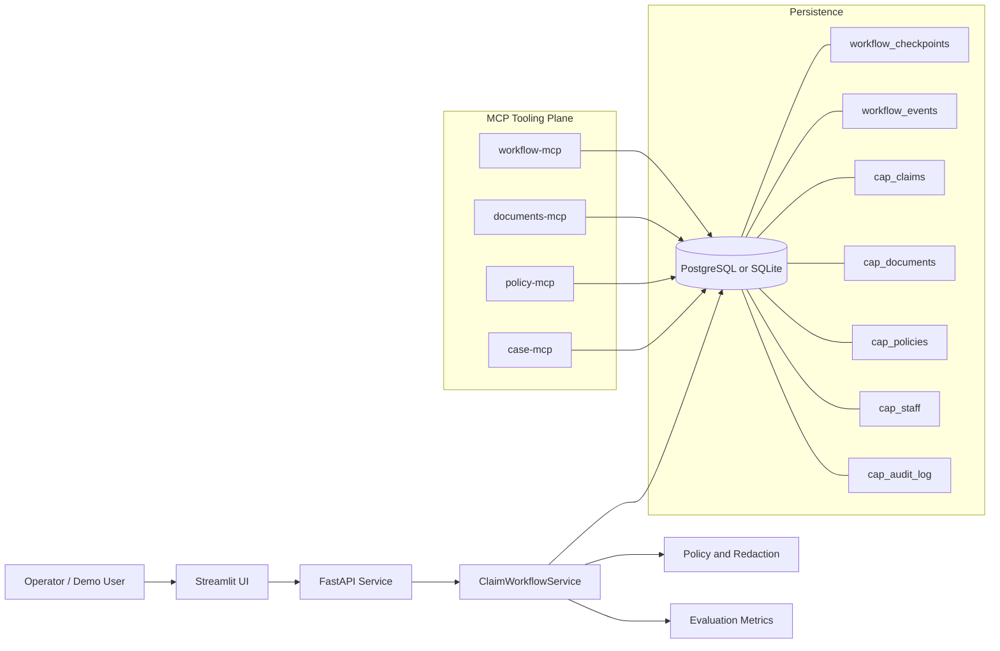

# Intelligent Claims Agent Architecture

This document provides a one-page architecture view for the project deliverable.

## High-Level Diagram

## Runtime Notes

- UI is optional but recommended for demos.
- API enforces a human decision gate for final claim disposition.
- Workflow checkpointing enables pause and resume.
- Event logging provides replay and auditability.
- MCP services expose bounded capabilities over shared data.

## Security and Governance Controls

- Evidence is treated as untrusted input.
- Injection patterns are flagged and routed to manual review.
- PII is redacted in summaries and traces where applicable.
- Human decision endpoint can be protected with API key.
